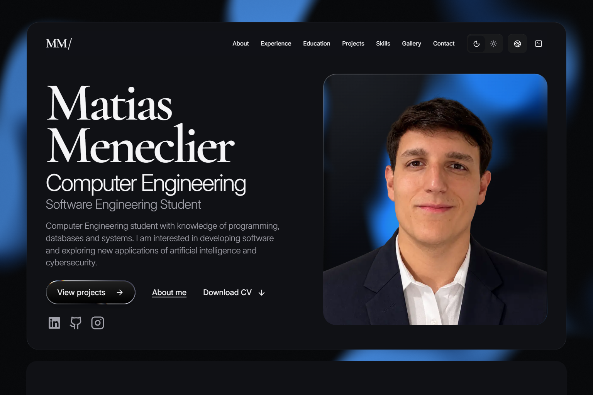
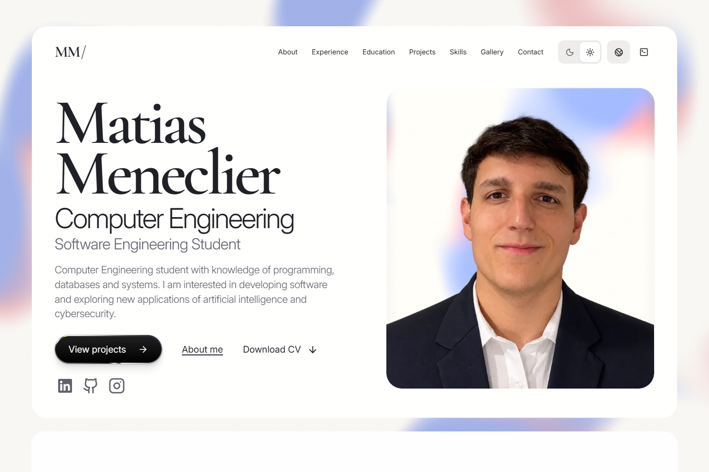
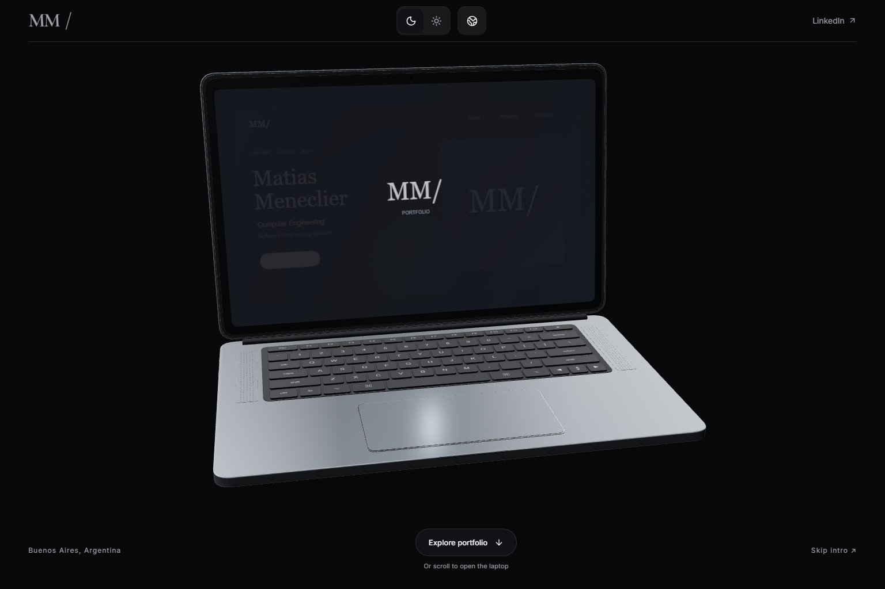
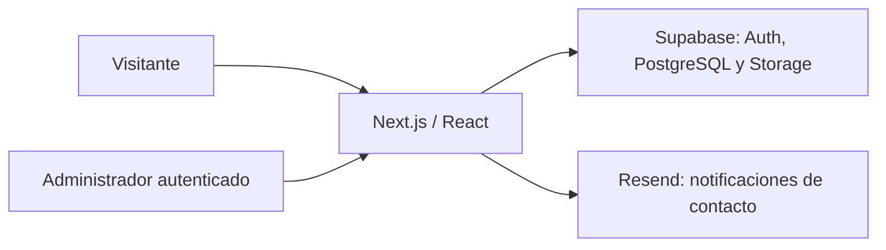

# Matias Meneclier · Portfolio

Mi portfolio personal y CV como estudiante de Ingeniería en Informática. Una experiencia interactiva con una laptop 3D, proyectos, presentación profesional y un panel privado para administrar el contenido.

**[Ver sitio](https://matiasmeneclier.com.ar)** · [CV en español](https://matiasmeneclier.com.ar/cv?lang=es) · [Resume in English](https://matiasmeneclier.com.ar/cv?lang=en) · [LinkedIn](https://www.linkedin.com/in/matias-meneclier-9bb8a83b6/)



## Vista previa

| Modo Soft                                                  | Introducción 3D                               |
| ---------------------------------------------------------- | --------------------------------------------- |
|  |  |

Las capturas muestran el sitio publicado. La interfaz se adapta a escritorio y celular, conserva su estructura al cambiar de tema y abre inicialmente en modo oscuro e inglés.

## Funcionalidades

- **Laptop 3D:** modelo propio, apertura con scroll y transición de 2,5 segundos al tocarla. El scroll es reversible y existe una alternativa con movimiento reducido.
- **Dos temas y dos idiomas:** Dark / Soft y ES / EN, con preferencias guardadas en el navegador.
- **Proyectos interactivos:** carrusel con flechas del teclado, botones y gestos táctiles, más una página de detalle por proyecto.
- **Liquid Glass:** una superficie compartida para el retrato, la barra flotante y el menú radial, con refracción y transiciones coordinadas.
- **Admin privado:** edición de textos, proyectos, experiencia, formación, archivos, traducciones y apariencia; visibilidad y orden por registro.
- **Contacto y CV:** mensajes almacenados en Supabase y notificados con Resend; CV imprimible en español e inglés y descargas PDF.

El contenido inicial incluye **secureGate**, **Portfolio personal**, **Cliped** —en desarrollo—, **Navegador GPS con brújula solar** y **Amplificador de audio analógico**. Las portadas conceptuales se distinguen de las capturas del sitio; no se incluyen proyectos ficticios en el contenido público inicial.

## Tecnologías

| Área                  | Herramientas                                         |
| --------------------- | ---------------------------------------------------- |
| Aplicación            | Next.js 16 · React 19 · TypeScript                   |
| Interfaz y movimiento | Tailwind CSS 4 · Motion · GSAP · Lucide              |
| Escena y fondo        | React Three Fiber · Drei · Three.js · Paper Shaders  |
| Datos y autenticación | Supabase · PostgreSQL · Auth · Storage · RLS         |
| Formularios           | Zod · API de Resend                                  |
| Verificación          | Node Test Runner · PGlite · Playwright · ESLint      |
| Despliegue            | Docker · Docker Compose · CasaOS · Cloudflare Tunnel |

## Probar localmente

Requisitos: **Node.js 24** y **pnpm 10.26.2**, versiones usadas en el Dockerfile.

```sh
git clone https://github.com/MatiasMeneclier/matias-portfolio.git
cd matias-portfolio
npm install --global pnpm@10.26.2
pnpm install --frozen-lockfile
pnpm dev
```

Abrir **http://127.0.0.1:3000**. Sin variables externas se puede recorrer el portfolio con el contenido incluido en el código. Para probar el panel, abrir `/admin/demo`: sus cambios se guardan solamente en ese navegador y se muestran en `/preview`.

La demo no inicia una sesión real ni publica cambios en Supabase. Está disponible en desarrollo; en producción permanece deshabilitada salvo que se active explícitamente `ENABLE_ADMIN_DEMO=true`.

Para probar tamaños de celular desde la PC, usar las herramientas de dispositivos de Chrome. Ver [pruebas móviles](docs/probar-mobile.md).

## Configuración

Copiar `.env.example` a `.env.local` y completar las variables de los servicios que se quieran activar. En PowerShell:

```powershell
Copy-Item .env.example .env.local
```

En macOS o Linux: `cp .env.example .env.local`.

| Variable                               | Uso                                                              |
| -------------------------------------- | ---------------------------------------------------------------- |
| `NEXT_PUBLIC_SITE_URL`                 | Origen del sitio; URL local en desarrollo y HTTPS en producción. |
| `NEXT_PUBLIC_SUPABASE_URL`             | URL pública de la API de Supabase.                               |
| `NEXT_PUBLIC_SUPABASE_PUBLISHABLE_KEY` | Clave pública para Auth y consultas sujetas a RLS.               |
| `RESEND_API_KEY`                       | Credencial privada del servidor para enviar correo.              |
| `CONTACT_EMAIL_FROM`                   | Remitente autorizado por Resend.                                 |
| `CONTACT_EMAIL_TO`                     | Destinatario de las notificaciones.                              |
| `ENABLE_ADMIN_DEMO`                    | Habilita la demo en producción; por defecto `false`.             |

El admin real requiere [configurar Supabase](docs/SUPABASE.md). El formulario requiere también [configurar Resend](docs/CONTACT.md). La aplicación no necesita una clave `service_role`. Los archivos `.env`, claves y respaldos están excluidos del repositorio.

## Administración y actualizaciones

El panel real se encuentra en `/admin/login`. El acceso exige una sesión válida y `app_metadata.role=admin`; el servidor y las políticas RLS comprueban el permiso.

Desde el panel se pueden crear y editar proyectos, subir archivos, traducir textos, ordenar registros y publicarlos u ocultarlos. Los registros nuevos comienzan ocultos. **Guardar publica el contenido en la base de datos**, y el visitante lo ve al recargar, sin recompilar la aplicación.

Los cambios en componentes, estilos o código requieren una nueva compilación y despliegue. **Subir un commit a GitHub no actualiza automáticamente este servidor**: no se configura un despliegue automático en este repositorio. Ver [despliegue y actualizaciones](docs/DEPLOYMENT.md).

## Arquitectura



El texto público se renderiza en servidor; la escena 3D y las interacciones se ejecutan en el navegador. La aplicación publicada y Supabase se alojan en el servidor propio del autor, y Cloudflare Tunnel conecta el dominio con Docker mediante HTTPS.

```text
app/                    Rutas públicas, admin y API
components/3d/          Laptop, cámara y transición de entrada
components/portfolio/   Secciones, navegación, proyectos y CV
components/admin/       Editores, ordenamiento y biblioteca de medios
components/ui/          Componentes compartidos
lib/                    Validación, contenido inicial, CV y Supabase
services/               Consultas del contenido publicado
store/                  Almacenamiento de la demo
supabase/migrations/    Esquema, permisos y evolución del contenido
public/                 Modelo 3D, retrato, fuentes y PDF
scripts/                Generación de contenido, modelo y CV
tests/                  Pruebas de datos, seguridad e interfaz
docs/                   Guías y capturas
```

## Verificación

```sh
pnpm lint
pnpm typecheck
pnpm test
pnpm build
```

Las pruebas de Node verifican validación, contenido, CV, mensajes y reglas de PostgreSQL mediante PGlite. No necesitan una cuenta remota de Supabase.

Con un servidor de desarrollo sin conexión a la base de datos de producción y Chrome instalado:

```sh
pnpm test:mobile-browser
```

`TEST_BASE_URL` permite indicar otro puerto. `tests/cv-browser.mjs` verifica el CV usando esa misma variable (por defecto, el puerto 3011). Las suites históricas `tests/browser.mjs` y `tests/update-browser.mjs` conservan expectativas de versiones anteriores y requieren revisión antes de reutilizarlas con los valores iniciales actuales.

## Documentación

- [Supabase: migraciones, permisos y administrador](docs/SUPABASE.md)
- [Supabase en CasaOS: servicios y mantenimiento](docs/SUPABASE-CASAOS.md)
- [Docker, dominio y actualizaciones](docs/DEPLOYMENT.md)
- [Formulario de contacto y Resend](docs/CONTACT.md)
- [CV: edición y generación de PDF](docs/CV.md)
- [Probar la experiencia de celular](docs/probar-mobile.md)

## Autor y recursos

**Matias Meneclier** · [GitHub](https://github.com/MatiasMeneclier) · [LinkedIn](https://www.linkedin.com/in/matias-meneclier-9bb8a83b6/) · [Portfolio](https://matiasmeneclier.com.ar)

Este repositorio documenta un proyecto personal; no incluye una licencia general de reutilización. Las fuentes conservan sus licencias en `public/fonts/`. El retrato y el contenido del CV pertenecen al autor; la laptop es un modelo genérico propio sin marcas de terceros.
